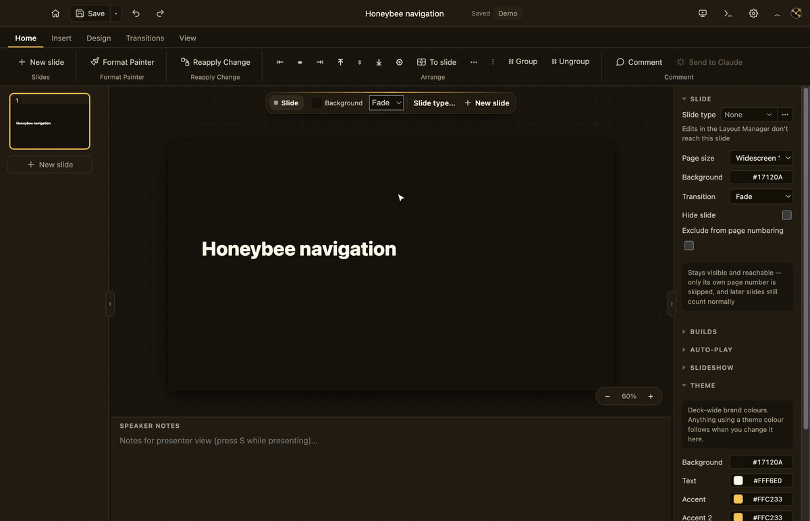

<p align="center">
  <a href="https://miqsoft.github.io/beeSlides/" title="BeeSlides docs">
    
  </a>
</p>

<h1 align="center">BeeSlides</h1>

<p align="center">
  <b>Slides that fit in a file.</b><br>
  A PowerPoint alternative that is a single HTML file — viewer, presenter and editor included.
</p>

<p align="center">
  <a href="#install"><b>Install</b></a> ·
  <a href="https://miqsoft.github.io/beeSlides/"><b>Documentation</b></a> ·
  <a href="https://miqsoft.github.io/beeSlides/app/BeeSlides.beeslides.html">Open in your browser</a> ·
  <a href="https://github.com/miqsoft/beeslides/discussions">Discussions</a>
</p>

<p align="center">
  
</p>

Make your deck in the desktop app, then send the file. Whoever receives it can open,
edit and present it in any browser and needs nothing else, because **the file is the
software**. Press Save and it rewrites itself with your deck inside.

## Why

Office documents used to be things you *had*. Now they're things you rent:
locked in someone's cloud, behind someone's login, readable only while a company
keeps its servers on. BeeSlides takes the other path.

- **One file, forever.** Deck, fonts, images, charts, animations and the editor
  travel together. A copy from 2026 will open in 2036.
- **View-source honest.** Your deck is a plain JSON block at the top of the file.
  No binary format, no lock-in.
- **Local-first, provably.** No server, ever. Offline mode switches every network
  feature off, and a test fails the build if code reaches the network another way.

## What's inside

| | |
|---|---|
| **Charts** | Bar, line, pie and scatter, drawn by our own engine and live while presenting. |
| **Interactive slides** | Click-through states, hover reveals and motion paths, so you can explore a diagram live. |
| **[Presenting](https://miqsoft.github.io/beeSlides/present/present/)** | Speaker view, pen and laser, kiosk mode — and [export](https://miqsoft.github.io/beeSlides/share/save/) as an editable deck, a read-only presentation or a PDF. |
| **[AI-ready](https://miqsoft.github.io/beeSlides/create/ai/)** | The desktop app has Claude built in. Any agent, chatbot or local model can also edit the deck's JSON. |
| **Private** | Password encryption (AES-GCM-256), an offline mode, and no accounts. |
| **[PowerPoint in, layouts out](https://miqsoft.github.io/beeSlides/create/layouts/#import-powerpoint)** | Import a `.pptx` with its masters as [slide types](https://miqsoft.github.io/beeSlides/create/layouts/); save any design as a reusable layout. |

The interface comes in 9 languages and works without a network connection. Editing is
desktop-first; phones view and present well.

## Install

**The desktop app** is the full BeeSlides: native menus, a start page with your
recent decks, and the AI features (Claude Code terminal, AI chat, Send to Claude,
PowerPoint with AI). Build and install it from source with one command:

```bash
git clone https://github.com/miqsoft/beeslides.git
cd beeslides
npm run setup          # macOS, Windows, Linux · needs Node.js 22.12+
```

It installs into Applications, the Start menu, or `~/.local`. Nothing is
downloaded pre-built or signed, so the app opens without a security warning.
Update with `git pull && npm run setup`; remove it with `npm run setup -- --uninstall`.
Details: [Install](https://miqsoft.github.io/beeSlides/start/install/).

**In a browser, no install:** every deck carries its own editor, so whoever you send
it to can open, edit and present it. To start one, open the blank
`BeeSlides.beeslides.html` ([hosted copy](https://miqsoft.github.io/beeSlides/app/BeeSlides.beeslides.html)).
The browser editor has no AI features.

## Use it with AI

The deck is plain JSON in one plaintext block (`#slidomingo-doc`), so any assistant
that can edit a file can edit your slides: [Claude Code](https://claude.com/claude-code),
Cursor or Aider. Any chatbot works too: *Save ▸ Copy document JSON*, ask, then
*Replace from JSON…*. Local models via Ollama, llama.cpp or LM Studio keep
everything on your machine. The one-page agent guide is
[docs/agents.md](docs/agents.md).

## Develop

```bash
cd slides && npm install
npm run dev            # editor dev server
npm run build:single   # → dist-single/BeeSlides.beeslides.html (the product)
cd .. && npm test      # all test rigs
```

| Read | For |
|---|---|
| [AGENTS.md](AGENTS.md) | How to work in this repo, for people and AI coding tools |
| [docs/architecture.md](docs/architecture.md) | How a `.beeslides.html` file is built, the runtime layout |
| [docs/format.md](docs/format.md) | The normative document-model spec |
| [docs/security.md](docs/security.md) | Security model: the file as the boundary, encryption, offline |
| [site/](https://miqsoft.github.io/beeSlides/contribute/docs/) | The docs site and its scripted walkthrough clips |
| [CONTRIBUTING.md](CONTRIBUTING.md) · [CHANGELOG.md](CHANGELOG.md) · [RELEASING](docs/RELEASING.md) | |

## Community

- **Questions:** [Discussions → Q&A](https://github.com/miqsoft/beeslides/discussions/categories/q-a)
- **Ideas:** [Discussions → Ideas](https://github.com/miqsoft/beeslides/discussions/categories/ideas)
- **Built something?** [Show and tell](https://github.com/miqsoft/beeslides/discussions/categories/show-and-tell)
- **Bugs:** [open an issue](https://github.com/miqsoft/beeslides/issues). Report security
  issues through [SECURITY.md](SECURITY.md), never in a public issue.

Planning a bigger contribution? Say what you're planning before you build it.
See [CONTRIBUTING.md](CONTRIBUTING.md).

Next on the roadmap: notes and spreadsheet apps built the same way, each one
self-contained HTML file.

## License

BeeSlides is free software under the [GNU Affero General Public License v3.0 or
later](LICENSE), © 2026 The BeeSlides authors. Anyone can use it, companies
included. If you distribute a modified version or run one as a service, you must
publish your source under the AGPL too. Commercial licenses are available.

**Your documents are yours.** An additional permission lets you share BeeSlides
files freely and keeps their content out of the AGPL. See [LICENSING.md](LICENSING.md).

BeeSlides reuses parts of the code of [Bento](https://github.com/nyblnet/bento) by
nyblnet and its contributors (MIT). Bundled runtime components (reveal.js, Moveable,
Selecto, Temml) are MIT, the embedded typefaces (Fraunces, Instrument Sans) are OFL,
and the gallery imagery is public domain (`scripts/gallery-photos/SOURCES.md`).
