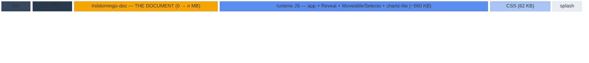
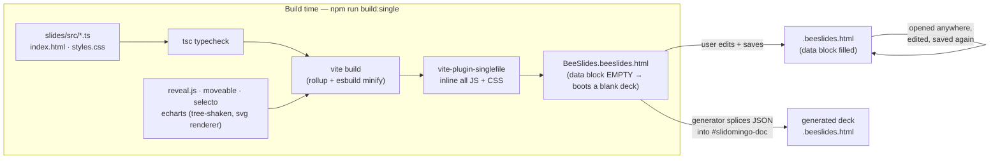
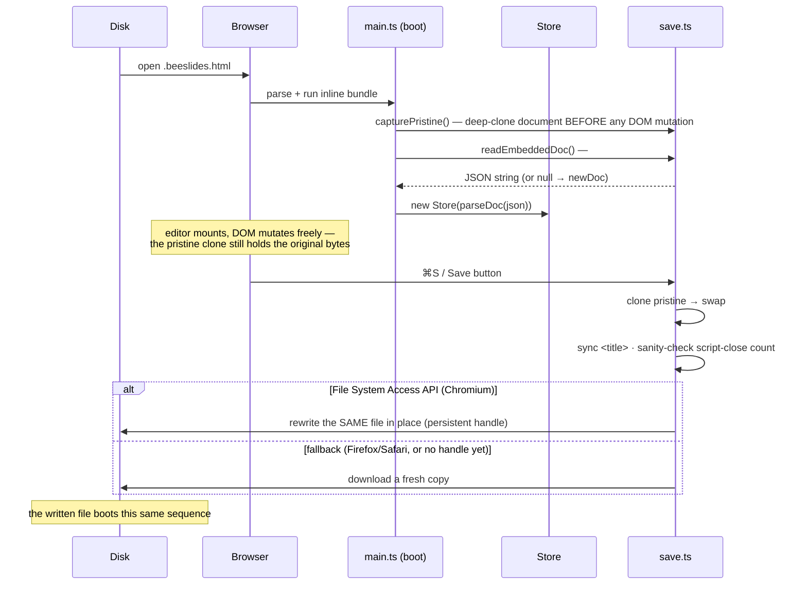
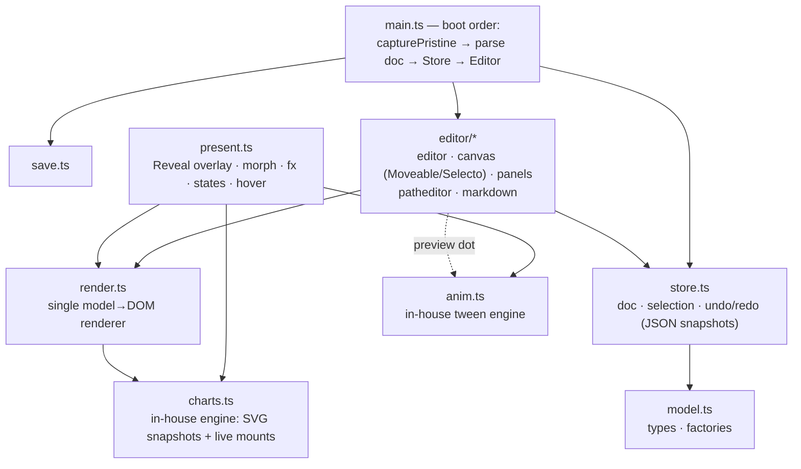

# BeeSlides — architecture

*Engineering reference, current as of July 2026. Covers how a `.beeslides.html`
file is constructed, what the on-disk format looks like, and how the runtime
is organized. User-facing documentation comes later, once the format
stabilizes for release.*

The core idea: **one HTML file is simultaneously the document, the viewer,
the presenter, and the editor.** There is no server, no install, and no
companion app — opening the file in a browser gives the full experience, and
the file saves *itself* back to disk with updated content (the TiddlyWiki
trick, modernized with the File System Access API).

---

> **v0.7.0 update**: the runtime now ships DEFLATE-compressed (shell ≈373KB,
> was 1.33MB) — byte order: chrome → NOTICE → tooling comment → **plaintext
> `#slidomingo-doc`** → splash → compressed payloads + 1KB loader last. The
> document block stays plaintext forever (AI/tooling + old-updater splice
> contract; scripts/shell-gate.mjs checks it). Charts are now in-house
> (`charts-lite`, MIT) — ECharts/zrender removed. Diagrams below describe the
> uncompressed layout; sizes predate compression.

> **2026-09 update**: signed self-update checking and live E2EE
> collaboration/sync — both described in older revisions of this document as
> §7 and §8 — were removed outright, not disabled. The app no longer touches
> any network origin at all outside the user's own asset URLs; see
> `docs/DECISIONS.md` for the dated entry. What follows describes the app as
> it exists today.

## 1. On-disk anatomy

A `.beeslides.html` file is ordinary, valid HTML. Its compartments, drawn
roughly to scale (widths √-compressed so the small parts stay visible —
exact numbers in the table below):



The amber block is the only part that changes between saves — everything
else is the fixed *shell*. Skeleton of the actual markup
(`dist-single/BeeSlides.beeslides.html`):

```html
<!DOCTYPE html>
<html lang="en">
<head>
  <meta charset="UTF-8"> <meta name="viewport" …> <meta name="generator" content="slidomingo-slides">
  <link rel="icon" href="data:image/svg+xml,…">
  <title>Deck title — BeeSlides</title>

  <!-- NOTICE — bundled open-source components …
       (license notices; part of the shell, so they travel with every copy) -->

  <!-- ═══ THE DOCUMENT ═══ (empty in a fresh shell → boots one blank slide) -->
  <script type="application/slidomingo+json" id="slidomingo-doc">
    {"format":"slidomingo/slides","title":"…","size":{…},"slides":[…]}
  </script>

  <!-- ═══ THE RUNTIME ═══ viewer + presenter + editor, one inlined bundle -->
  <script type="module">/* ≈560 KB minified JS */</script>
  <style>/* ≈62 KB minified CSS — editor chrome, present overlay, print rules */</style>
  <style>/* splash CSS — paints before the bundle parses */</style>
</head>
<body>
  <div id="slidomingo-splash">…</div>   <!-- pure-CSS boot splash -->
  <div id="app"></div>             <!-- the runtime mounts the editor here -->
</body>
</html>
```

Layout and sizes, in file order — illustrative figures for the *uncompressed*
runtime (the shipped shell is DEFLATE-compressed, see the v0.7.0 note above; the
*order* is what's fixed, byte offsets shift with the data block's size):

| # | Part | ≈ size (raw) | What it is |
|---|---|---|---|
| 1 | Head chrome | 0.7 KB | doctype, metas, favicon, title |
| 2 | NOTICE comment | 2 KB | bundled-library license notices |
| 3 | **`#slidomingo-doc` data block** | **0 → *n* MB** | **the document** — JSON, `<` escaped; assets are data URIs, so image-heavy decks dominate the file |
| 4 | Runtime JS | ~560 KB | app (~120 KB) + Reveal.js + Moveable/Selecto family + charts-lite (in-house SVG charts, replaced ECharts in v0.7.0) |
| 5 | Runtime CSS | 62 KB | editor + present + print styles |
| 6 | Splash CSS + body mounts | 2 KB | splash `<style>`/`<div>`, `#app` mount |

Once DEFLATE-compressed for shipping, the whole shell is well under 600 KB on
disk before any document content (≈558 KB in the current build; it grows slowly
as features land — the v0.7.0 note records the compression milestone).

Two hard rules keep the file well-formed:

1. **The data block JSON escapes every `<` as `\u003c`**, so the string
   `</script>` can physically never appear inside it and terminate the block.
2. **The runtime source never contains a literal script-close tag** — the one
   place that needs it (`save.ts`) builds it by string concatenation, because
   that code ships *inside* a `<script>` element of the very file it writes.

## 2. How a file is constructed

Two producers make BeeSlides files: the Vite build (makes the empty *shell*) and
the runtime's own save path (makes every subsequent copy). Generators (like
the testing deck transpiler) are a third, minor path: they take the shell and
splice a JSON document into its data block.



The saved file is again a complete construction kit — there is no difference
in kind between the shell and a user's document, only the data block content.

## 3. The self-save loop



Consequences of the pristine-clone design:

- Anything present in the shipped HTML (NOTICE comment, splash, favicon)
  survives every save unchanged — documents self-carry their license notices.
- The runtime version is **pinned inside each document**: opening an old file
  runs its old editor. Upgrading a document means re-splicing its data block
  into a newer shell (generators do exactly this).
- Editor state (selection, zoom, panel widths) never leaks into the file;
  only the model JSON changes between saves. UI prefs live in `localStorage`.

## 4. The document model (`format: "slidomingo/slides"`)

The data block holds one JSON object. Sketch of the current shape — see
`src/model.ts` for the authoritative types:

```
SlidomingoDoc
├─ format: "slidomingo/slides"
├─ title
├─ size: { width: 1280, height: 720 }   ← canonical 16:9; per-doc, presets in the slide panel
├─ theme: { fontFamily, … }
├─ present?: { slideNumber?, controls?, progress? }
├─ assets?: { key → data URI }        ← images, fonts; referenced as "asset:key"
├─ fonts?: [{ family, asset, weight?, style? }]  ← @font-face injected at boot
├─ layouts?: Slide[]                  ← templates; instantiation KEEPS element ids (lineage → morph continuity)
└─ slides: Slide[]                 ← linear order; states sit right after their parent
   ├─ id                           ← stable; morph matches elements ACROSS slides by element id
   ├─ background · transition      ← none | fade | slide | zoom | morph | push | wipe | cover | split (+ transitionDir)
   ├─ name? · notes
   ├─ stateOf?                     ← marks a hidden interactive state of another slide
   ├─ hover?                       ← { type:'focus-group', dim } | { type:'reveal', default }
   ├─ comments?                       ← review threads, anchored to element/point/slide (editor-only; window.slidomingo.comments() for tooling)
   └─ elements: SlideElement[]     ← array order = paint order (z)
      ├─ common: id · x y w h · rotation · opacity
      │          fx? · link? · group? · groupId? · showOnHover? · role?
      ├─ text:  html (sanitized rich text: b/i/u/s/code/br, styled span, a, ul/ol/li…) · placeholder? · fontSize · fontFamily
      │         fontWeight · color · align · valign · lineHeight · letterSpacing?
      ├─ shape: shape (rect|ellipse|triangle|arrow|line|path) · fill · fillGradient?
      │         stroke · strokeWidth · strokeStyle? (solid|dashed|dotted) · radius
      │         lineStart?/lineEnd? (none|arrow|dot|bar) · d?/pathBox? (path kind)
      ├─ image: src ("asset:key" or data URI) · fit · radius
      ├─ svg:   asset?/markup? · css? (scoped per element at render)
      ├─ chart: preset? · option · source? ← ECharts-SHAPED pure-JSON option
      │         (template-string formatters only — functions can't serialize);
      │         drawn by the in-house charts-lite engine; source={tableId}
      │         binds it live to a table element
      ├─ table: columns[{w}] · rows[{cells[{html,align?,color?,bg?,bold?}]}]
      │         · header · style{headerBg,zebra?,borderColor,cellPad…,radius…}
      │         ← a real HTML <table>, rendered by the shared renderer
      └─ media: kind (video|audio) · src (data URI | URL | "asset:key")
                · poster? fit? radius? · controls/autoplay/loop/muted
                ← autoplay fires in present mode only
```

Text also resolves dynamic-field tokens at render time — `{{page}}`,
`{{pages}}`, `{{title}}`, `{{date}}`, `{{time}}` (page/pages take a zero-pad
width, `{{page:2}}`) — so page numbering re-flows when slides move. The MODEL
stores the raw token; only the rendered output is resolved.

`fx` carries all presentation behavior:

| Field | Meaning |
|---|---|
| `enter: 'fade' \| 'fade-up' \| 'fade-down' \| 'slide-left/right/up/down'`, `order` | staggered entrance; equal `order` values enter together |
| `step`, `exitStep`, `exit`, `exitDur`, `byParagraph` | click builds: `step` = the click an element arrives on, `exitStep` the click it leaves on, `byParagraph` splits text one paragraph per click; `order` only staggers within a click (see `slides/src/builds.ts`) |
| `countUp` | numbers in the text animate 0 → final |
| `ambient: 'kenburns'`, `ken: {dir, scale, duration}` | photo drift loop, or one-shot zoom-in/out settle |
| `loop: {type:'dash-march', …}` | marching dashed strokes |
| `loop: {type:'motion-path', path, duration, delay}` | element travels an SVG path **relative to its rest position** (first point = 0,0) |

Interactivity is composed from three primitives, all plain data: element
`link` (click → jump to slide id), slide `stateOf` (hidden variants reached by
links, morphing on shared element ids), and `showOnHover` sets with slide
`hover` (in-slide hover reveals). Charts on either side of a morph with the
same element id additionally animate their *data* — the in-house chart engine
tweens the option's numeric leaves (a bar⇄pie type change stages a fade+sweep).

## 5. Runtime organization



One renderer, four surfaces — the same `render.ts` output is consumed
everywhere, which is what keeps WYSIWYG honest:

| Surface | Host | Charts | Notes |
|---|---|---|---|
| Editor canvas | `.ed-stage-scale` (CSS-scaled) | static SVG snapshot | Moveable control box mounts *inside* the scale wrapper (see CLAUDE.md gotcha #1) |
| Sidebar thumbnails | per-slide mini surface | snapshot | `svg` elements collapse to `` for cheapness |
| Present | Reveal.js sections | **live instance** (tooltips, dataZoom) | fx/morph/states run here only |
| PDF export | `#slidomingo-print`, `@page` 1600×900 | snapshot | state slides excluded |

Animation is fully in-house (`anim.ts`, no GSAP): tween channels for
opacity/transform/colors/SVG attributes/motion paths, a per-element transform
registry that preserves model rotation, and kill/query APIs that the exit
restore and the 2.8 s wall-clock settle guarantee are built on. Morph
geometry is **model-driven** — both slides' frames are in the doc, so nothing
measures the DOM.

## 6. Format invariants

Things generators and future format revisions must not break:

1. `format: "slidomingo/slides"` plus additive, optional fields — old files must
   open in newer shells (unknown fields are preserved by parse → serialize).
2. Element **ids are identity**: morphs match on them across slides, states
   sync from parents by id lineage, links point at slide ids. Generators must
   emit deterministic ids.
3. Data block JSON must stay `<`-escaped; chart options and text HTML must be
   pure data (the sanitizer whitelist and the no-functions rule exist so a
   document can never smuggle executable code through the model).
4. Asset references are `asset:` keys into `doc.assets`; nothing outside the
   file may be fetched at view time (single-file promise, and the CSP story
   for future hosting).
5. Motion paths are stored relative to the element's rest position; the first
   path point is that position by definition.
6. Every document carries a stable `docId` (uuid, minted at creation, minted
   on load for pre-docId files). It is identity for future format evolution —
   never derive it from content, never regenerate it on save.

## 7. No network dependency

A shipped file pins its runtime forever — it never needs the network, and
nothing in the running app reaches one either. There is no self-update
check, no relay, no telemetry: `kernel/src/net.ts` is the one chokepoint
every network-capable call goes through, and `scripts/test-offline.ts` fails
the build if any other file calls `fetch`/`WebSocket` directly. The Offline
switch in the About dialog is a no-op today in the sense that there is
nothing left for it to block beyond a document's own remote media
references (`<video src="https://…">` and the like) — see `docs/security.md`.
